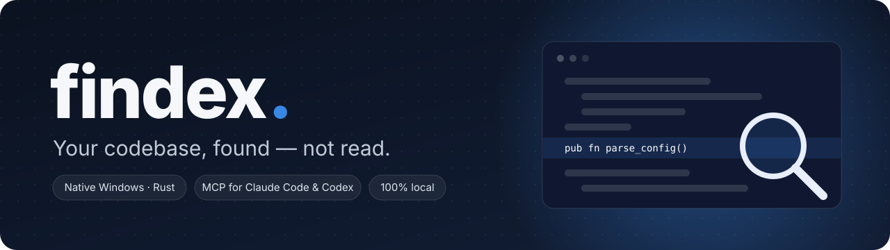
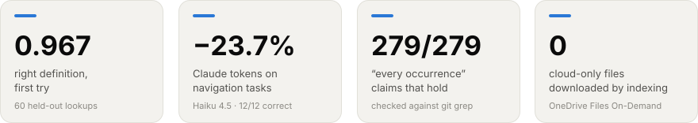
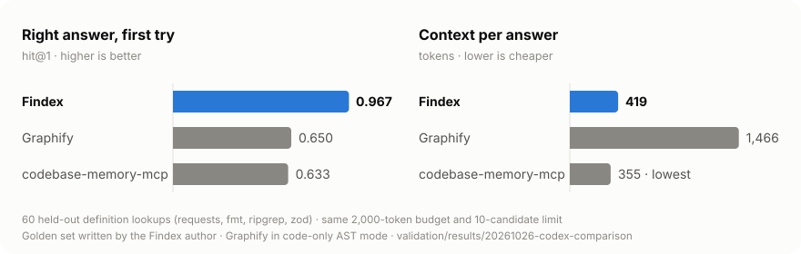
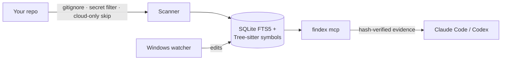

<p align="center">
  
</p>

<p align="center">
  <a href="https://github.com/brutalstein/findex/actions/workflows/ci.yml"></a>
  
  
  
</p>

Your AI coding assistant is brilliant. It also explores your repo one `grep` at a
time, and you pay for every line it reads on the way.

**Findex hands Claude Code and Codex a local, hash-verified map of your code.**
Ask "who calls `parse_config`?" for its definition and matching call sites
with enclosing functions, or ask for its tests. Coverage and limits accompany
the evidence; name matches do not prove type-resolved calls.
Findex retrieves locally without API keys. The official assistant may send
selected excerpts to its provider.

**Current source (2026-10-29):** native Windows checks pass 188 Rust tests on
stable and MSRV plus 49 offline Python tests. Native syntax extraction covers
Rust, Python, JavaScript, TypeScript/TSX, C, C++, Go, Java and C#.
Imported compiler identities can now be resolved from a source position, including
aliases and same-named methods. This requires a SCIP/LSP snapshot; ordinary
context retrieval remains lexical/syntactic. Context ranking separates conceptual tasks from exact
symbol lookup, checks local Rust receiver annotations and states its evidence
scope explicitly. Exact filename words and nearby evidence now contribute to
task retrieval. On 65 reused historical issues, this iteration raises hit@1
from **40.0% to 44.6%**, and gold recall@10 from **79.2% to 80.8%**, at the same 1,200-token
rendered budget. The 60% / 90% targets remain unmet. Higher conditional call
precision comes with substantially fewer confident calls; it does not establish
general semantic resolution or better bugfix outcomes.
[Measured changes, remaining gaps and tradeoffs](docs/engineering/COMPETITIVE_GAPS_20261029.md).

**Previously packaged 0.2.0 preview:** Claude and Codex plugin integration,
extracted packages, Cloud Files, loopback SMB and 100k-file synthetic scaling
were verified locally on the previous build. That package is unsigned; no public release is published
yet. [Verification and remaining limits](docs/engineering/RELEASE_CANDIDATE_HARDENING_20261027.md).

<p align="center">
  
</p>

## The receipts

We compared the native MCP servers on 115 frozen navigation queries: 55 new
held-out lookups and 60 historical regression controls. The table shows the
55 new queries. Source content, binaries and graph hashes were frozen first.

<p align="center">
  
</p>

| | Findex (compact) | Graphify (code-only MCP) | codebase-memory-mcp (tree) |
|---|:---:|:---:|:---:|
| Right file, first try (hit@1) | **0.982** | 0.873 | 0.855 |
| Correct definition line, first try | **0.982** | 0.764 | 0.727 |
| Mean reciprocal rank | **0.991** | 0.897 | 0.885 |
| Raw tool output tokens per query | **222** | 2,663 | 240 |
| Median warm latency | **3.67 ms** | 33.78 ms | 25.73 ms |

Findex's optional compact format cuts its own JSON output by 29.0% on this
subset, preserving every field through a documented lossless encoding; all 115
source-hit lists match the previous Findex binary. Across all 115 queries,
Findex compact averages 264 tokens and codebase tree 266: a narrow margin.
Codebase is still smaller on three of four corpora and on the historical
60-query subset. Codebase exact lookups use anchored regex, and tree/JSON hit
lists are checked for equivalence. Accuracy uses a 2,000-token visible budget;
the raw column includes Graphify's over-budget output. The golden is
author-created and reused during format iteration; this is no universal win.
[Method, losses and reproduction](validation/results/20261027-performance-comparison/NOTE.md).

**Latest live bugfix pilot (2026-10-29):** six Codex subscription starts; all
three tools pass both independent Windows host regressions. Findex uses 494,954
total input+output tokens, Graphify 723,857 and codebase-memory 419,689: Findex
uses 31.6% less than Graphify and 17.9% more than codebase-memory, and its model
sessions are slower than both. No SCIP preparation is selected in this run.
Two reused public tasks do not establish general superiority.
[Frozen inputs, patches, costs and limits](validation/results/20261029-locality-bugfix-live/NOTE.md).

**Earlier semantic-prepared live bugfix pilot:** six Codex subscription starts, two real tasks per tool.
Findex passes 1/2 with one 300-second timeout; Graphify and codebase-memory pass
2/2 each under independent Windows host regression grading. On the one complete
matched task, Findex uses 33.6% fewer total input+output tokens than Graphify and
43.9% fewer than codebase-memory, while taking longer. A separately authorized
Findex diagnostic retry passes in 34.1 seconds; it does not replace the timeout.
The two-task token comparison is incomplete. [Results, patches and limits](validation/results/20261028-semantic-bugfix-live/NOTE.md).

**Earlier real Codex navigation pilot:** six sequential sessions, two tasks per tool,
all answers correct. Findex used 149,527 total input+output tokens, Graphify
217,280 and codebase-memory 592,385. Cache differences are reported separately.
The pilot used the earlier matrix-only build. Two tasks with one repetition
per arm cannot establish broad savings or code-fix
success. [Pilot evidence](validation/results/20261027-codex-live/NOTE.md).

**In real Claude Code sessions** (108 sessions, Haiku 4.5), Findex cut tokens by
**23.7 %** on held-out navigation tasks, with 12/12 answers correct
([study](validation/campaigns/vnext/CLAUDE_AB_RESULTS.md)). On concept questions
and code changes, it did not save tokens, and we don't pretend it does.
Every claim, its number and its verdict: **[docs/EVIDENCE.md](docs/EVIDENCE.md)**.

## 60-second start

**Claude Code plugin**

```powershell
claude plugin marketplace add brutalstein/findex
claude plugin install findex@findex-marketplace
```

The plugin needs `findex.exe`, either on `PATH` or named by `FINDEX_BIN`. It
never downloads or builds one behind your back. Then just ask Claude in English
or Turkish, or use `/findex:navigate`, `/findex:map-project` or
`/findex:trace-impact`.

**Codex plugin**

```powershell
.\plugin\scripts\install-codex.ps1 -Binary C:\Tools\findex\findex.exe
```

Updates use a verified runtime path per executable hash, allowing existing
Windows MCP sessions to keep running. Start a new Codex session after updating.

**Build it yourself** (Windows x64, Rust MSVC toolchain)

```powershell
cargo build --release -p findex
.\target\release\findex.exe context "who calls parse_config"
```

**Compiler-backed identity lookup** (Rust example; installed rust-analyzer required)

```powershell
rust-analyzer scip .
findex graph-import-scip .\index.scip
findex graph-symbol --at src\lib.rs 8 10
```

The location uses a one-based line and zero-based UTF-8 byte column. Claude and
Codex can use `findex_graph_symbol` with `path`, `line` and `column`, or an exact
imported symbol ID. Evidence is checked against source hashes; ambiguous, stale
and incomplete results stay explicit. A semantic reference does not prove a
runtime call. [Semantics, encoding and limits](docs/reference.md#semantic-reference-imports-and-impact-graph-experimental).

## What you get

Native Windows scaling checks cover 200 to 100,000 synthetic source files.
On this machine, the 10k-file initial-index median fell from 49.01 to 10.21 s
against the previous build; the 100k-file run used 23.39 MiB peak working set.
These are local synthetic measurements, not an all-project or competitor speed
claim. Reconciliation remains capped at 100,000 files and 512 KiB per source.
[Method, warm-query results and limits](docs/engineering/RELEASE_CANDIDATE_HARDENING_20261027.md#native-scaling-and-query-work).

| | |
|---|---|
| 🎯 **One-call context** | Definition, call sites with their enclosing function, or tests, each with a coverage line the model can trust. |
| 🔎 **Symbol-aware search** | Tree-sitter definitions for Rust, Python, TypeScript/JavaScript and C++, plus SQLite FTS5 with camelCase-aware ranking. |
| ⚡ **Source-checked** | A native Windows watcher updates the index; every returned hit is re-hashed against the file before it reaches the model. |
| 🧭 **Owner-aware callers** | Owner/receiver filtering for Rust; unknown receivers remain possible calls, and excluded external-crate matches are counted. |
| 🔗 **Optional semantic graph** | Import SCIP or captured LSP references for verified file impact. |
| 🌍 **Speaks your language** | Intent routing in English and Turkish. |

## Built to be boring in production

- **Local only.** No server, no telemetry, no model calls. The official
  Claude Code client and its login are never touched.
- **OneDrive-safe.** Cloud-only files are skipped, never downloaded, and
  counted. Before this fix, indexing a OneDrive folder downloaded every file.
- **Fails closed.** A corrupt or newer-format index is refused and left
  intact; `findex forget` and `findex index` rebuild it.
- **SQLite removal.** Text of deleted, excluded or unreadable files is wiped
  from SQLite pages, FTS segments and the WAL. Symlinks and junctions are not
  followed, and secret-looking files are skipped.
- **Verifiable builds.** The tagged CI release workflow generates an SBOM,
  SHA-256 files and build-provenance attestations. Local preview packages have
  checksums and an SBOM, and carry no GitHub attestation. A license and source
  policy (`cargo deny`) and a RustSec audit run in CI.



## What it won't do (yet)

Name-matched calls are not compiler-resolved proof. Findex does not scan for
every possible secret, run on macOS or Linux, or come Authenticode-signed (no
certificate yet; verify SHA-256 and CI provenance when available). It also
won't stop your model from ignoring good advice, but it does make good advice
cheaper.

## Learn more

[Evidence](docs/EVIDENCE.md) · [Technical reference](docs/reference.md) ·
[Architecture](docs/architecture.md) · [Security](SECURITY.md) ·
[Changelog](CHANGELOG.md) · [Contributing](CONTRIBUTING.md) ·
[Roadmap](docs/roadmap.md)

<sub>MIT licensed. Findex is an independent project and is not affiliated with
Anthropic or OpenAI. It launches the official clients and never impersonates
them.</sub>
