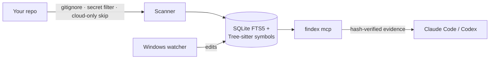

<p align="center">
  
</p>

<p align="center">
  <a href="https://github.com/brutalstein/findex/actions/workflows/ci.yml"></a>
  
  
  
</p>

Your AI coding assistant is brilliant. It also explores your repo one `grep` at a
time, and you pay for every line it reads on the way.

**Findex hands Claude Code and Codex a local, hash-verified map of your code.**
Ask "who calls `parse_config`?" and the answer comes back in one call: the
definition, every call site with its enclosing function, and the tests, plus a
line telling the model whether that list is complete.
No cloud. No API keys. No guessing.

<p align="center">
  
</p>

## The receipts

We benchmarked Findex against two popular code-navigation tools on 60 held-out
lookups. Same tasks, same budget, same rules, losses included.

<p align="center">
  
</p>

| | Findex | Graphify (code-only) | codebase-memory-mcp |
|---|:---:|:---:|:---:|
| Right file, first try (hit@1) | **0.967** | 0.650 | 0.633 |
| Mean reciprocal rank | **0.983** | 0.676 | 0.646 |
| Context tokens per answer | 419 | 1,466 | **355** |
| Median latency | **8 ms** | 904 ms¹ | 18 ms |

Yes, codebase-memory-mcp sends fewer tokens. It is also wrong a third of the
time, and a short wrong answer is the most expensive kind. Fine print: the
golden set was written by the Findex author, which tilts the field in our
favour; ¹ Graphify's figure includes CLI start-up. Full method and raw data:
[`validation/results/20261026-codex-comparison`](validation/results/20261026-codex-comparison/NOTE.md).

**In real Claude Code sessions** (108 sessions, Haiku 4.5), Findex cut tokens by
**23.7 %** on held-out navigation tasks, with 12/12 answers correct
([study](validation/campaigns/vnext/CLAUDE_AB_RESULTS.md)). On concept questions
and code changes, it did not save tokens, and we don't pretend it does.
Every claim, its number and its verdict: **[docs/EVIDENCE.md](docs/EVIDENCE.md)**.

## 60-second start

**Claude Code plugin**

```powershell
claude plugin marketplace add brutalstein/findex
claude plugin install findex@findex-marketplace
```

The plugin needs `findex.exe`, either on `PATH` or named by `FINDEX_BIN`. It
never downloads or builds one behind your back. Then just ask Claude in English
or Turkish, or use `/findex:navigate`, `/findex:map-project` or
`/findex:trace-impact`.

**Codex plugin**

```powershell
.\plugin\scripts\install-codex.ps1 -Binary C:\Tools\findex\findex.exe
```

**Build it yourself** (Windows x64, Rust MSVC toolchain)

```powershell
cargo build --release -p findex
.\target\release\findex.exe context "who calls parse_config"
```

## What you get

| | |
|---|---|
| 🎯 **One-call context** | Definition, call sites with their enclosing function, or tests, each with a coverage line the model can trust. |
| 🔎 **Symbol-aware search** | Tree-sitter definitions for Rust, Python, TypeScript/JavaScript and C++, plus SQLite FTS5 with camelCase-aware ranking. |
| ⚡ **Always fresh** | A native Windows watcher keeps the index current; every hit is re-hashed against the file before it reaches the model. |
| 🧭 **Owner-aware callers** | `Type::method` and `self.method` resolved for Rust; calls into external crates are excluded and counted. |
| 🔗 **Optional semantic graph** | Import SCIP or captured LSP references for verified file impact. |
| 🌍 **Speaks your language** | Intent routing in English and Turkish. |

## Built to be boring in production

- **Local only.** No server, no telemetry, no model calls. The official
  Claude Code client and its login are never touched.
- **OneDrive-safe.** Cloud-only files are skipped, never downloaded, and
  counted. Before this fix, indexing a OneDrive folder downloaded every file.
- **Fails closed.** A corrupt or newer-format index is refused and left
  intact; `findex forget` and `findex index` rebuild it.
- **Leaves no traces.** Text of deleted, excluded or unreadable files is wiped
  from SQLite pages, FTS segments and the WAL. Symlinks and junctions are not
  followed, and secret-looking files are skipped.
- **Verifiable releases.** Each release ships an SBOM, SHA-256 files and a
  build-provenance attestation. A license and source policy (`cargo deny`) and
  a RustSec audit run on every change.



## What it won't do (yet)

It won't build a type-resolved call graph outside Rust, scan for every
possible secret, run on macOS or Linux, or come Authenticode-signed (no
certificate yet; verify the SHA-256 file and the attestation instead). It also
won't stop your model from ignoring good advice, but it does make good advice
cheaper.

## Learn more

[Evidence](docs/EVIDENCE.md) · [Technical reference](docs/reference.md) ·
[Architecture](docs/architecture.md) · [Security](SECURITY.md) ·
[Changelog](CHANGELOG.md) · [Contributing](CONTRIBUTING.md) ·
[Roadmap](docs/roadmap.md)

<sub>MIT licensed. Findex is an independent project and is not affiliated with
Anthropic or OpenAI. It launches the official clients and never impersonates
them.</sub>
